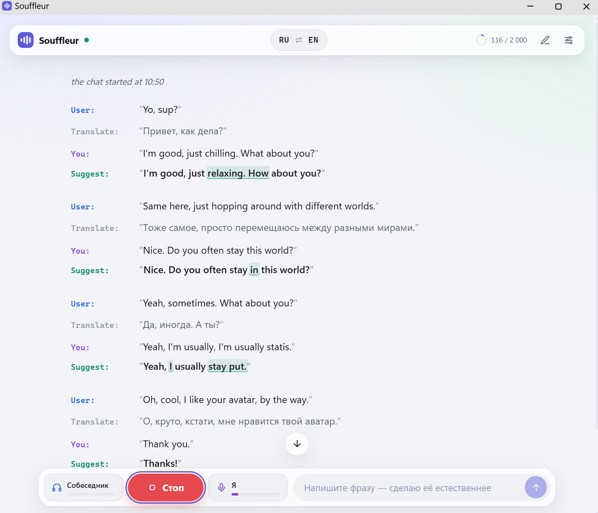

# Souffleur

Суфлёр для разговорной практики на иностранном языке (Windows).



Программа одновременно слушает звук компьютера (собеседника в звонке, видео) и ваш микрофон:

- **User** — речь собеседника: распознаётся и переводится (A → B, а если он говорит на B, то в A для понимания);
- **You** — ваша фраза дословно, со всеми ошибками;
- **Suggest** — как сказать то же самое правильно и естественно (изменённые слова подсвечены, кнопка 🔊 озвучивает вариант голосом носителя).

```text
_the chat started at 19:42_

User:      "So, how was Lisbon? Did you get to see much?"
Translate: "Ну как Лиссабон? Удалось много посмотреть?"
You:       "Yes, it was very interesting. We was there five days and I seen many old streets"
Suggest:   "Yeah, it was amazing! We were there for five days, and I got to wander around lots of old streets."
Note:      «we was» → «we were», «I seen» → «I saw»; «got to» в разговоре звучит естественнее.

User:      "And the food? I've heard the seafood is incredible."
Translate: "А еда? Говорят, морепродукты там невероятные."
You:       "Yes, very... как сказать... свежая, especially the fish"
Suggest:   "Oh yes, everything was so fresh, especially the fish."

User:      "Any plans for tonight? We could grab a drink."
Translate: "Какие планы на вечер? Можем где-нибудь посидеть."
You:       "Sorry, I finish work at 7 and I want to go home to see my family."
Suggest:   "Sorry, I don't wrap up until seven, and then I'm heading straight home to spend some time with my family."
```

В этом примере:

- **перевод собеседника.** Он говорит на английском (B), поэтому перевод идёт на русский (A), чтобы вы поняли. Речь на русском переводится на английский;
- **исправление ошибок.** Грамматика поправлена, а в окне программы изменённые слова подсвечиваются. С опцией «Объяснять ошибки» появляется строка **Note** с коротким разбором;
- **смешанная фраза.** Если не хватило слов и вы перешли на русский, Suggest всё равно даёт фразу целиком на английском;
- **правильная, но «учебная» фраза** становится разговорной. Насколько сильно переписывать, задаётся стилем: «Исправить», «Естественно» или «Продвинуто»;
- **контекст.** Подсказки учитывают предыдущие реплики разговора.

## Запуск

1. Дважды щёлкните **`run.bat`**. При первом запуске он сам создаст `.venv` и установит зависимости (нужен Python 3.10+, лучше 3.13 — <https://www.python.org/downloads/>).
2. Откроется окно приложения. Нажмите ⚙ → вставьте **API ключ OpenAI** → «Проверить».
3. Нажмите **Слушать** (или `Ctrl+M`).

Закрыли окно — программа сама остановит прослушивание и завершится (это можно выключить в настройках).

Параметры: `run.bat --window browser` — открыть во вкладке браузера, `--window none` — не открывать, `--port 8765` — порт.

## Как это работает

```text
WASAPI loopback ─┐                                   ┌─ gpt-4o-mini-transcribe ─ GPT (перевод, поток) ─┐
                 ├─ 16 кГц ─ Silero VAD ─ фразы ─────┤                                                 ├─ окно + лог .md
Микрофон ────────┘     (+ самый громкий голос)       └─ gpt-4o-mini-transcribe ─ GPT (Suggest, поток) ─┘
```

- **Детектор речи** Silero VAD работает локально (~0.2 мс на 32 мс звука): в OpenAI уходят только фразы с человеческим голосом, без музыки и тишины.
- **Самый громкий голос.** Программа следит за уровнем основного собеседника: фразы, которые тише него на N дБ (по умолчанию 12), отбрасываются, а чужие тихие голоса в паузах основного глушатся. Это фильтр по громкости, а не разделение дикторов: если два человека говорят одновременно и одинаково громко, распознаются оба.
- **Скорость.** Фраза завершается после паузы 650 мс, результат приходит потоком — обычно через 1–2 с после конца речи.
- **Контекст.** В GPT уходит последняя переписка в пределах окна контекста (по умолчанию 2000 токенов); при переполнении самые старые сообщения обрезаются. Граница видна в чате пунктирной линией, индикатор в шапке показывает заполнение, клик по нему очищает контекст.

## Аудиоустройства

- **Микрофон** — по умолчанию используется микрофон Windows "по умолчанию"; другой можно выбрать в настройках.
- **Звук собеседника** берётся с устройства вывода Windows "по умолчанию". Если звук идёт в отдельное устройство вывода (например, канал аудиомикшера), выберите его — тогда программа слышит только собеседника, без музыки и игр.
- Если микрофон передаёт абсолютную тишину (выключен в Windows или в программе микрофона), программа предупредит об этом.
- **Эхо-защита** (по умолчанию «пока говорю я — не слушать собеседника») не даёт вашему голосу попасть в реплики собеседника, если он слышен в наушниках (мониторинг микрофона). Если вы без наушников, выберите второй вариант.

## Лог разговоров

Каждый чат пишется в `logs/ГГГГ-ММ-ДД_ЧЧ-ММ-СС.md` в формате как выше. Каждая реплика дописывается одной операцией с `fsync`, поэтому при аварийном закрытии программы всё сказанное до этого момента сохраняется. Кнопка ✎ в шапке начинает новый чат (и новый файл).

## Настройки

Хранятся в `data/settings.json` (API ключ — только на этом компьютере; вместо него можно задать переменную окружения `OPENAI_API_KEY`).

| Настройка | По умолчанию | Комментарий |
| --- | --- | --- |
| Модель GPT | `gpt-4.1-mini` | быстрая и недорогая; можно `gpt-5.4-mini`, `gpt-5.4-nano` и др. |
| Распознавание | `gpt-4o-mini-transcribe` | ≈ $0.003 за минуту речи |
| Языки A / B | русский / английский | A — родной, B — тренируемый, 35 языков |
| Как улучшать | «Естественно» | «Исправить» — минимум правок, «Продвинуто» — идиомы и богатая лексика |
| Base URL | — | для прокси или OpenAI-совместимого API (также работает `HTTPS_PROXY`) |

Остальное — порог детектора речи, пауза конца фразы, отсечение тихих голосов, эхо-защита, окно контекста, масштаб и тема интерфейса — тоже в окне настроек.

## Структура

```text
run.bat              запуск (venv + зависимости + приложение)
app/__main__.py      сервер на 127.0.0.1 и окно приложения (Edge/Chrome --app)
app/server.py        FastAPI + WebSocket, конвейер «фраза → текст → GPT»
app/audio.py         захват WASAPI, нарезка фраз, выделение самого громкого голоса
app/vad.py           Silero VAD (ONNX) без torch
app/ai.py            вызовы OpenAI
app/prompts.py       промпты перевода и коуча
app/session.py       чат, окно контекста, устойчивый лог
app/static/          интерфейс (HTML/CSS/JS без сборки)
models/              silero_vad.onnx и его лицензия
docs/screenshots/    скриншоты для README
```

## Отказ от ответственности

- Код написан с помощью нейросети и может содержать ошибки.
- Программа предоставляется «как есть», без каких-либо гарантий (см. [LICENSE](LICENSE)). Владелец репозитория и авторы не несут ответственности за любой ущерб, связанный с её использованием, включая потерю данных, расходы на OpenAI API и последствия неточных переводов и подсказок.
- Программа записывает ваш микрофон и звук компьютера и отправляет фрагменты речи в OpenAI. Перед использованием убедитесь, что это законно там, где вы находитесь, и что собеседники согласны на запись и обработку их речи. Соблюдение законов, условий использования OpenAI и сервисов, в которых идёт разговор, — ответственность пользователя.
- Переводы и подсказки генерирует языковая модель, и они могут быть неточными. Не полагайтесь на них там, где ошибка обойдётся дорого.
- Расходы на OpenAI API оплачивает пользователь по своему ключу. Логи разговоров хранятся на компьютере в открытом виде.

## Лицензия

[MIT](LICENSE). Модель Silero VAD (`models/silero_vad.onnx`) распространяется без изменений по лицензии MIT © Silero Team — см. [models/LICENSE](models/LICENSE).
